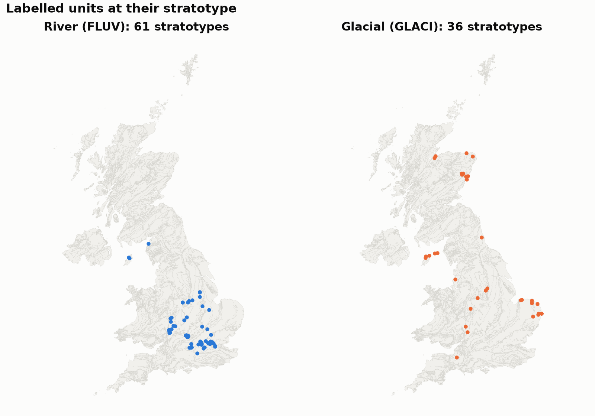
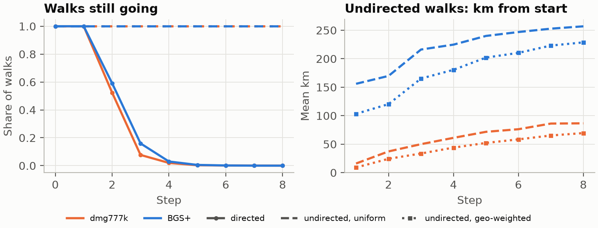

## 1. Goal and datasets

[GeoRDF2Vec](https://arxiv.org/html/2504.17099v1) assigns a location to every node by flooding geometries through the graph, then biases RDF2Vec random walks towards geographically close neighbours. We plan two changes: relation-aware flooding and adaptive walk length. Before implementing them, we analysed what the data offers for each (`notebooks/dmg777k_eda.ipynb`, `notebooks/bgs_eda.ipynb`). Test labels were never used.

| | **dmg777k**  | **BGS+**  |
|--------|----------------------|----------------------|
| Graph | 776,920 triples, 332,194 nodes, 60 relations | 916,199 triples, 273,963 nodes, 103 relations |
| Task (majority) | 5 classes, 8,396 labels (47.8%) | river (FLUV) vs glacial (GLACI), 146 labels |
| Geometries | 21,208 WKT; every labelled node has its own | 48,603 WKT; no labelled node has its own |

We chose BGS+ as the second dataset (the paper's other one, DBpedia, was too big). It is a standard RDF2Vec/R-GCN benchmark, and differs from dmg777k in it's structure.

## 2. Structure, geometries and labels

| | dmg777k | BGS+ |
|-------------|---------------------------|---------------------------|
| Entities / literals | 148,127 / 184,067  | 103,055 / 170,908 |
| Degree | median 1; largest hub 65,576  | median 1; largest hub 83,024 |
| No outgoing edge | 58.5% of nodes | 69.5% of nodes |
| Relations | 60; top 5 hold 42.5% of edges | 103; top 5 hold 29.6% of edges |

Both graphs are heavy-tailed multigraphs (56k and 95k node pairs with several relations) with one connected component, so flooding reaches every node. The big hubs are classes and shared values (`Not Entered`, photographers' names), not places. Most nodes are literals, which end any walk that follows edge direction.

- **Geometries.** dmg777k: 11,315 polygons and 9,893 points. 99.9% of monuments have 2–6 geometries, and 44,710 geometry nodes are empty stubs linked only to their class. BGS+: 23,917 polygons, 21,943 points and 2,743 lines, in British National Grid metres, which we reproject to WGS84 (36 invalid, 2 empty). Coverage is uneven: monuments cluster along rivers and in South Limburg; stratotypes where geology is well studied.
- **How locations reach the labelled nodes.** Each Dutch monument owns its geometry (2 hops: `hasGeometry` → `asWKT`). No BGS+ rock unit does. Only 3,290 of 17,943 units have a stratotype, and the map links to just 154 units, none of them labelled.
- **Labels.** dmg777k has 5 unnamed classes, with moderate imbalance (3.8% to 47.8%), so we report macro F1. BGS+ has 93 FLUV and 53 GLACI, we split it 94 / 23 / 29. One test unit moves accuracy by 3–4 points, so we use repeated cross-validation over training and validation units. 144 of the 146 BGS+ units are young superficial deposits, not bedrock.
- **Leakage.** The target relations are absent. In dmg777k, near-pure features (specific cities, streets) cover 1.3% of validation monuments. In BGS+, 8 features pure in training (parent unit, the age `QO`, texts like "Ground surface.") cover 9 of 23 validation units, 8 correctly. Graph structure alone explains much of the BGS+ class, consistent with published RDF2Vec accuracy of about 0.87.

## 3. Findings

**Location relates to the class: modestly in dmg777k, strongly in BGS+.** A nearest-neighbour classifier on coordinates alone reaches macro F1 0.26 on dmg777k (shuffled labels: 0.13). On BGS+, using a unit's stratotype it reaches 0.87 (shuffled: 0.47). Glacial deposits lie in the north (Figure 1, left).

**Flooding gives many nodes a meaningless location.** Flooding crosses every relation, including `rdf:type`. A class node linked to almost every geometry therefore inherits their national centroid and passes it on. In dmg777k this affects 18.5% of nodes (via `geosparql:Geometry`). In BGS+ it affects 50.3% (via `skos:Concept`), including 49 of the 146 labelled units.

**Relations differ sharply in how spatial they are.** We grouped located entities by a shared object and measured each entity's median distance to its group's centre:

| Kind | dmg777k (baseline 75 km) | BGS+ (baseline 248 km) |
|-------|-----------------------|-----------------------|
| Spatial | postal code 30 m, city 370 m, municipality 2 km | location description 80 m, stratotype 4 km |
| Regional | province 22 km | parent unit 44 km, map units of one entry 85 km |
| Not spatial | build year, house number, `type`: 66–81 km | ages, colour, status, `type`: 106–248 km |

**Relation-aware flooding helps measurably on BGS+, before any training.** We hid the stratotype links of the 97 labelled units that have one, re-ran flooding, and measured the distance to the true site:

| Flooding variant | Labelled units at national centroid | Hold-out median error | Location-only macro F1 |
|--------------------------|-------------|------------|------------|
| Repo (all relations) | 49 | 389 km | 0.72 |
| Without `rdf:type` | 0 | 72 km | 0.76 |
| Without hubs (degree > 1,000) | 0 | 51 km | 0.71 |
| Without schema/attribute relations | 0 | **59 km** | **0.78** |

**Walk direction decides whether walk length matters** (Figure 1, right). Walks that follow edge direction, as the authors' code does, end on a literal: with a limit of 8 they average 1.6–1.8 steps on both datasets, so the length limit is almost never reached. Walks that may also go backwards always reach 8 steps and keep drifting away from the start: 16 → 87 km on dmg777k, 156 → 257 km on BGS+. Geographic weights keep them 7–21 km (dmg777k) and 28–53 km (BGS+) closer. However, 91–97% of undirected BGS+ walks pass through a national-centroid hub.

{width=36%} {width=62%}

*Figure 1. Left: BGS+ labelled units at their stratotype, by class. Right: random walks from labelled nodes (limit 8): share still going per step, and mean distance from the start for undirected walks, uniform vs geo-weighted.*

## 4. Consequences for our contributions

| Contribution | Evidence | Next step |
|--------|----------------------------|----------------------|
| Relation-aware flooding | Hubs corrupt 18.5% / 50.3% of locations. On BGS+, dropping non-spatial relations cuts hold-out error 389 → 59 km and raises F1 0.72 → 0.78. Dropping by degree does not raise F1. | Derive the relation list from measured dispersion. Run the hold-out on all 3,290 BGS stratotypes and on dmg777k. |
| Adaptive walk length | Directed walks end after about 1.7 steps. Undirected walks reach full length and keep drifting. | Fix walk direction first, then compare length rules on both datasets. |

**Limitations and baseline.** The authors' code needs fixes before a baseline run (word2vec trains on no data as committed; longitude and latitude are swapped; see the notebooks). BGS+ has only 146 labels (fold spread ±0.08 macro F1), so we will compare methods with repeated cross-validation and paired tests. The kNN scores measure how much signal location carries, not embedding quality.
